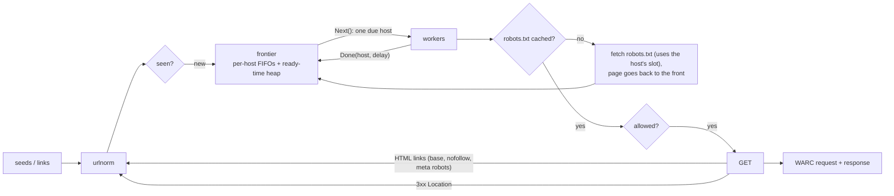

# trawl

A polite web crawler that archives to WARC. It implements RFC 9309 robots.txt, gives each host
its own schedule (one request at a time, with a delay after it finishes), and writes WARC 1.1
records that `warcio` validates. A synthetic-web harness audits every crawl from the server's
side.

[](https://github.com/eshaan2418/trawl/actions/workflows/ci.yml)
[](LICENSE)


```
$ make demo
$ trawl -concurrency 16 -delay 100ms -max-pages 400 -warc demo.warc.gz <20 seeds>
{ "pages": 400, "pages_per_second": 126.7, "robots_fetches": 20, "robots_blocked": 56,
  "status": { "200": 398, "301": 2 }, "warc_records": 801, "errors": 0 }
server-side audit:
{ "page_requests": 400, "robots_violations": 0, "nofollow_fetches": 0, "duplicate_page_fetches": 0,
  "min_gap_ms": 102.4, "min_gap_ms_by_class": { "crawl-delay-0.2s": 203.1, "default": 102.4 } }
```

(Real output, reformatted onto fewer lines; the full text is in `bench/results/demo.txt`.)

## Why this exists

Crawling is easy to write and easy to get wrong in ways that hurt other people's servers. A
crawler can request a host many times at once. It can treat a failing robots.txt as
permission. It can fetch the same page twice under different URLs, or ignore `Crawl-delay`.
The site owner sees each of these as abuse. trawl treats politeness as a scheduling invariant
and robots.txt as a spec to implement exactly. It verifies both with an independent
server-side audit rather than trusting its own logs. The output is a standard WARC archive
that `warcio`, pywb, and CDX indexers can read.

## Highlights

- **Politeness by construction.** A frontier of per-host FIFO queues, with a min-heap of hosts
  keyed by the next allowed time. A host has at most one request in flight, and the next
  starts at least `delay` after the previous one *finished*. Cost is O(log hosts) per URL,
  whatever the queue depth.
- **RFC 9309 robots.txt.**
  - Group merging and longest-match rules (allow wins ties), with `*` and `$` wildcards.
  - Percent-encoding normalisation and the 500 KiB limit.
  - Status semantics: 4xx means allow, 5xx means disallow.
  - The matcher is differentially fuzzed against a regexp reference.
- **robots.txt costs a politeness slot.** The first page on a host waits one delay after the
  robots.txt request instead of following it immediately.
- **Fuzzed URL normalisation.** An idempotence fuzzer found and fixed five canonicalisation
  bugs (empty hosts, trailing dots, raw spaces, lone `%`, and `%2e` dot segments, the last one
  found by CI). Any one of them would have caused
  duplicate fetches.
- **Crash-safe WARC 1.1.**
  - One gzip member per record, with request/response pairs linked by `WARC-Concurrent-To`.
  - SHA-1 block and payload digests.
  - Graceful shutdown lets in-flight fetches finish, so the archive always parses.
- **Operable.** Prometheus metrics, pprof, structured logs, a bounded frontier
  (backpressure), and a body size cap.

## Quick start

```sh
git clone https://github.com/eshaan2418/trawl && cd trawl
make test        # unit + integration tests with the race detector
make demo        # crawl a local 20-host synthetic web and audit it
make warc-check  # crawl, then validate the archive with warcio (needs uv)
```

Works the same on macOS and Linux with Go 1.24+.

## Usage

```sh
# Crawl two sites, 1 s between requests per host (or the site's Crawl-delay if larger),
# stay on their hosts, archive everything, expose metrics.
bin/trawl -same-host -max-pages 5000 -max-depth 4 -delay 1s \
  -warc crawl.warc.gz -metrics 127.0.0.1:9090 \
  https://example.org/ https://example.com/docs/

curl -s 127.0.0.1:9090/metrics | grep trawl_      # Prometheus
go tool pprof http://127.0.0.1:9090/debug/pprof/profile
```

Ctrl-C stops taking new URLs, finishes in-flight fetches, closes the WARC, and prints stats.

As a library:

```go
w, _ := warc.Create("out.warc.gz", map[string]string{"software": "my-archiver"})
c := crawler.New(crawler.Config{Concurrency: 32, DefaultDelay: 2 * time.Second, MaxPages: 10_000, WARC: w})
stats, err := c.Run(ctx, []string{"https://example.org/"})
_ = w.Close()

rules := robots.Parse(body, "mybot")
ok := rules.Allowed("/private/page?x=1")
```

## Architecture



Workers ask the frontier for the next *due* host, take its oldest URL, and check the cached
robots policy. They fetch, archive, extract links, and report back with `Done(host, delay)`.
Redirects are queued as new URLs, not followed inline, so the target gets its own robots
check, de-duplication, and politeness slot. Details: [docs/DESIGN.md](docs/DESIGN.md).
Questions and answers about the design: [docs/DEEP_DIVE.md](docs/DEEP_DIVE.md).

## Benchmarks

Setup: `cmd/synthweb` serves 50 hosts × 200 pages with 2 ms latency per response, over
loopback. Each host's behaviour depends on its index:
- disallowed paths;
- a `Crawl-delay: 0.2`;
- a 404 or 503 robots.txt;
- a 301 redirect;
- `rel=nofollow` links.

It records every request, so politeness and compliance are measured *by the server*. The
baseline is gocolly/colly v2.3.0, configured to match as closely as it allows:
- one `LimitRule` per host, with `Parallelism: 1` and the same delay;
- robots.txt obeyed;
- the same global concurrency (32) and a 3,000-page cap.

Each configuration ran 5 times, interleaved. Hardware: Apple M5 Pro, Go 1.27.3. Other jobs were
running on the machine (load average 7–10, recorded per run). Raw data:
`bench/results/crawl.jsonl`; reproduce with `make bench`.

| delay | crawler | pages/s (median) | peak RSS | robots violations | duplicate fetches | smallest gap on one host | gap on `Crawl-delay: 0.2` hosts |
|---|---|---:|---:|---:|---:|---:|---:|
| none | trawl | **10,021** | 25 MB | **0** | **0** | 2.1 ms | 202 ms |
| none | colly | 2,711 | 41 MB | 1,156–1,229 | 222–227 | 0.0 ms | 0.0–2.1 ms |
| 50 ms | trawl | **503** | 26 MB | **0** | **0** | 52.1 ms | 202 ms |
| 50 ms | colly | 188 | 45 MB | 1,377–1,387 | 250–254 | 0.5 ms | 2.1–2.2 ms |

What the numbers say:

- **trawl never violates its contract.** Across all runs there were zero requests to disallowed
  paths and zero pages from hosts whose robots.txt failed with 503. No page was fetched twice,
  and the smallest gap between two requests to one host was never below the configured delay.
  `Crawl-delay: 0.2` was honoured (≥ 202 ms).
- **colly, as configured, does not keep those guarantees on this workload.**
  - Every robots violation the server attributed to it was a page from a host whose
    robots.txt returned 503.
  - Its duplicates disappear when the synthetic web has no cross-host links, the only links
    carrying a `#fragment`. So it re-fetches fragment-only URL variants
    (`bench/results/colly-diagnosis.jsonl`).
  - With a 50 ms delay, its smallest page-to-page gap on one host was 2.7 ms.
- **Throughput.** trawl is 3.7x faster with no delay and 2.7x faster with 50 ms. With 50 ms,
  the policy itself bounds the rate:
  - 30 hosts at one request per about 52 ms (delay plus latency);
  - 10 hosts at `Crawl-delay: 0.2`;
  - 10 hosts that get nothing because robots.txt returns 503.

  That allows about 625 pages/s, and trawl reaches 503, about 80% of it, with robots.txt
  fetches and redirects using the rest.

Caveats: this is one synthetic workload on loopback. It measures scheduling and policy, not
real-network behaviour. colly checks the page cap when a request starts, so it fetched more
than 3,000 pages; compare rates, not totals. An earlier baseline used one `DomainGlob: "*"`
rule, which serialises colly across *all* hosts; it was replaced as unfair (DEEP_DIVE §13).

## Design decisions and trade-offs

- **Delay measured from the end of a fetch**, not the start. Slow servers automatically get
  more breathing room.
- **Hosts, not origins, are the politeness unit.** `http://a` and `https://a` share one
  schedule because they are usually the same machine. robots.txt is still cached per origin,
  as the RFC requires.
- **Unreachable robots.txt means crawl nothing.** This follows the RFC: 5xx, network errors,
  and (a deliberate extension) 429 all count, and trawl retries after 10 minutes.
- **No query-parameter sorting.** It would merge URLs that real sites treat differently.
- **Records are self-consistent rather than byte-exact.** Go removes chunked encoding before
  the body is read, so archived headers state the real `Content-Length`.
- **In-memory frontier and seen set.** Simple and fast; it bounds crawls to what fits in RAM
  and does not survive restarts.

## Testing

- **robots**: RFC 9309-style examples, edge cases, `Crawl-delay` and sitemaps, the size limit,
  and two fuzzers: one differential (the matcher against a regexp translation), and one
  checking determinism and that `/robots.txt` is always allowed.
- **urlnorm**: a canonicalisation table, rejection of non-HTTP URLs, and an idempotence fuzzer
  (`Normalize(Normalize(x)) == Normalize(x)`).
- **frontier**: 8 workers × 20 hosts with no concurrent host access, the minimum gap, and
  exactly-once delivery. Also backpressure, drain and cancellation semantics, `PushFront`, and
  `Close`.
- **warc**: concurrent writes read back with digest verification, request/response pairing,
  the truncation flag, and a known SHA-1/base32 vector.
- **crawler**, integration with the synthetic web:
  - the server-side audit: no violations, duplicates, or nofollow fetches, gaps at least the
    delay and the Crawl-delay, and one robots.txt fetch per host;
  - every page archived as a parseable pair;
  - an exact `MaxPages`, depth and same-host scope;
  - graceful cancellation leaving a complete archive;
  - robots status handling (404, 401, 503, 429);
  - link extraction (`base`, `rel=nofollow`, meta robots).
- CI on macOS and Linux runs `go test -race`, 10 s per fuzz target, `golangci-lint`, an
  end-to-end crawl validated with `warcio check`, and the demo.

## Limitations and roadmap

- The frontier and seen set live in memory: no resume after a crash, and the seen set grows
  with every discovered URL.
- Politeness is per hostname, not per IP; many virtual hosts on one server each get their own
  budget.
- No adaptive back-off on 429/503 for page fetches, no `Retry-After`, no sitemap ingestion,
  no conditional re-crawl.
- HTML only (no JavaScript rendering); link extraction covers `<a>` and `<area>`.
- Roadmap: an on-disk frontier with resume, per-IP budgets, adaptive delays, sitemap seeding,
  and CDX index output.

## Project structure

```
robots/      RFC 9309 parser and matcher (+ fuzz tests)
urlnorm/     URL canonicalisation (+ idempotence fuzzer)
frontier/    per-host queues, ready-time heap, backpressure
warc/        WARC 1.1 writer and verifying reader
crawler/     fetch loop, robots cache, link extraction, metrics
synthweb/    synthetic multi-host web with a server-side compliance audit
cmd/trawl    CLI (graceful shutdown, Prometheus, pprof)
cmd/synthweb benchmark server
bench/       benchmark and diagnosis scripts, colly baseline (separate module), results
docs/        DESIGN.md, DEEP_DIVE.md
```

## License

MIT. See [LICENSE](LICENSE).
