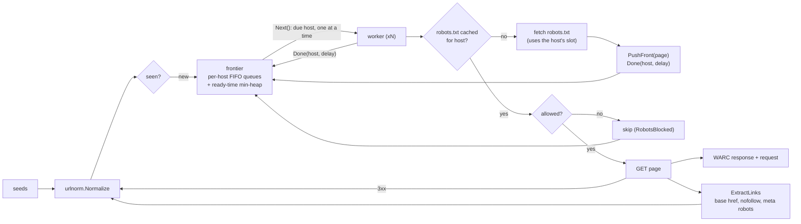

# trawl design

## Frontier

Politeness is a scheduling problem: never have two requests to one host in flight, and wait
at least the host's delay between the end of one fetch and the start of the next. The
frontier keeps:

- a FIFO queue per host (`hostState.queue` with a head index, so popping is O(1));
- a min-heap of hosts ordered by `readyAt`. A host is on the heap only while it has queued
  URLs and no fetch in flight.

`Next` pops the heap top if it is due, marks the host in flight, and returns its oldest URL. If
nothing is due it sleeps until the top's `readyAt` or until something changes. `Done(host,
delay)` sets `readyAt = now + delay` and puts the host back on the heap if it still has URLs.
Each call costs O(log hosts), independent of how many URLs are queued. Busy and idle hosts
cost nothing.

Wake-ups use a single-slot channel. Because one token can wake only one waiter, a waiter that
takes an item re-signals when more hosts are due, and a waiter that returns `false` (drained,
closed, or cancelled) re-signals so the others notice too. `Close` never closes the channel,
so a late `Push` or `Done` cannot panic. Cancellation is checked first on every loop
iteration. An earlier version returned due work even after cancellation, so "graceful
shutdown" crawled to completion (6.4 s in `TestGracefulCancellation`); the regression test is
`TestCancelledContextStopsEvenWhenWorkIsDue`.

The frontier is bounded (`MaxQueued`): `Push` fails when full, and the crawler counts the drop
(`trawl_frontier_dropped_total`) instead of growing without limit.

## robots.txt (RFC 9309)

- Parsing is line-based with a 500 KiB limit (the RFC's minimum) and BOM and comment
  handling. Field names are case-insensitive.
- **Group selection**: consecutive `user-agent` lines form one group. The crawler takes every
  group whose product token equals its own (case-insensitive) and merges them; if none match,
  it takes the `*` groups. If there is no `*` group either, everything is allowed. An agent
  with its own empty group does *not* fall back to `*`.
- **Matching**: the longest matching pattern wins, and `allow` wins a tie. `*` matches any
  sequence and a trailing `$` anchors at the end of path + query. `match` is a two-pointer
  wildcard matcher with backtracking to the last `*`: linear in practice, no regexp, no
  recursion. A differential fuzz test checks it against a regexp translation of the same
  pattern.
- **Encoding**: patterns and paths are percent-normalised the same way (unreserved escapes
  decoded, hex upper-cased, non-ASCII encoded), so `/%7Ejoe` and `/~joe` match.
- **Status codes** (RFC 9309 §2.3.1): 2xx parses; 4xx means *unavailable*, so everything is
  allowed (including 401/403); 5xx and network errors mean *unreachable*, so everything is
  disallowed and the fetch is retried after 10 minutes. 429 is treated like 5xx, a deliberate
  choice: a server asking us to slow down should not be read as "crawl everything".
- **Politeness interaction**: fetching robots.txt *is* a request to the host, so it consumes
  the host's slot. The page that triggered it goes back to the front of the host's queue and
  waits one politeness delay. trawl therefore never sends the robots.txt request and the first
  page request back to back.
- `Crawl-delay` (not in the RFC, but widely used) raises the host's delay, capped by
  `MaxDelay` (30 s).

## URL normalisation

The scheme and host are lower-cased, and trailing dots and default ports are removed. The
fragment is dropped, and dot segments are resolved while keeping a trailing slash. Percent-
escapes are normalised, and bytes that are invalid in a query are escaped. Query parameter
order is preserved, because reordering can change meaning. The fuzz test asserts idempotence,
`Normalize(Normalize(x)) == Normalize(x)`, and it found five real bugs:

1. the host `.` normalised to an empty host;
2. `host..` lost one dot per pass;
3. raw spaces in queries were trimmed on re-parse;
4. a lone `%` combined with a decoded escape to form a new one;
5. `%2e` was decoded to `.` after dot segments had been resolved (found by the CI fuzz run on
   Linux), so escapes are now normalised first.

## Fetching

- Redirects are not followed inline (`CheckRedirect` returns `ErrUseLastResponse`). The 3xx
  response is archived and its `Location` is queued as a new URL at the same depth, so the
  target gets its own de-duplication, robots check, and politeness slot.
- Bodies are capped at `MaxBodyBytes`; truncated records carry `WARC-Truncated: length`.
- Transparent gzip is disabled, so archived bytes are what the server sent. Go removes chunked
  transfer encoding before the body is read, so the archived headers drop `Transfer-Encoding`
  and state the real `Content-Length`, which keeps the record self-consistent.
- In-flight fetches use `context.WithoutCancel` plus a timeout. On shutdown no new URLs are
  taken, but started fetches complete and are archived whole.
- Links: `<a>` and `<area>` hrefs resolved against `<base href>`; `rel="nofollow"` links are
  skipped; `<meta name="robots" content="nofollow|none">` and `X-Robots-Tag: nofollow|none`
  stop link extraction for the page.

## WARC 1.1

One `warcinfo` record, then a `response` and a `request` record per fetch (the request has
`WARC-Concurrent-To` pointing at the response). Each record is a separate gzip member, which
is the convention that lets CDX indexes seek to a record by byte offset. Records carry
`WARC-Record-ID` (random UUID v4), `WARC-Date`, `WARC-Target-URI`, `WARC-IP-Address`,
`WARC-Block-Digest`, and `WARC-Payload-Digest` (SHA-1, base32). The writer is mutex-guarded;
`warc.Reader` reads files back and verifies block digests. CI also validates a crawl's output
with `warcio`, the Python reference library.

## Observability

Prometheus metrics: fetches by status, bytes, a fetch-duration histogram, errors, robots
blocks, frontier drops, and queue, in-flight, and host gauges. `net/http/pprof` is served on
the same `-metrics` address. Logs use `log/slog`.
